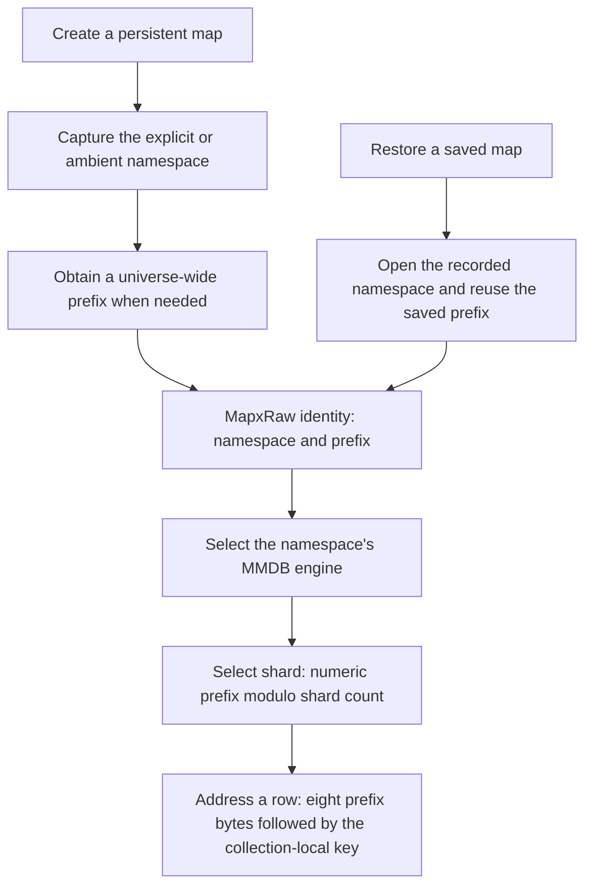
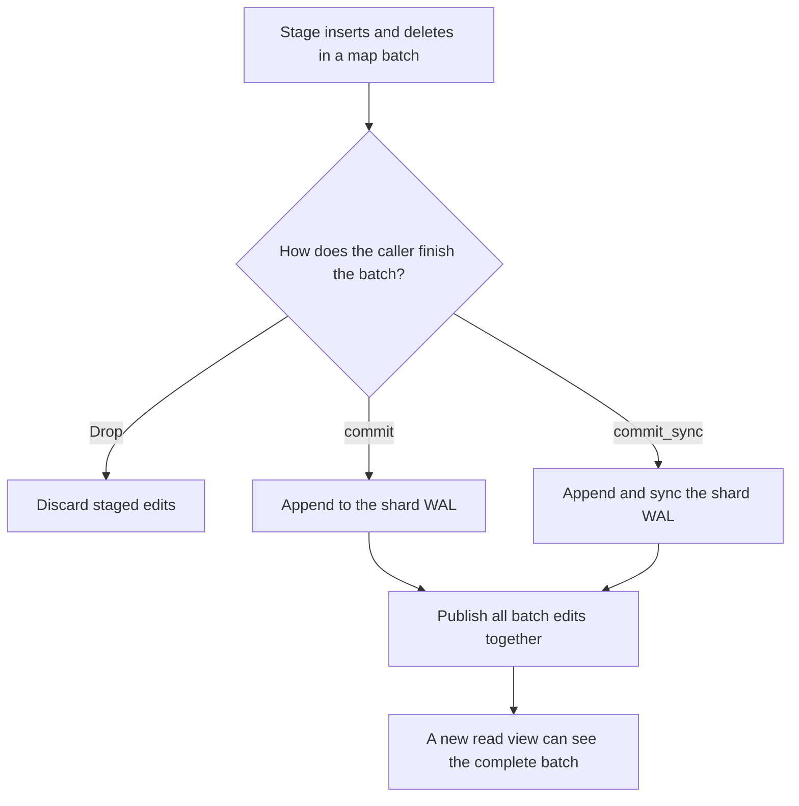
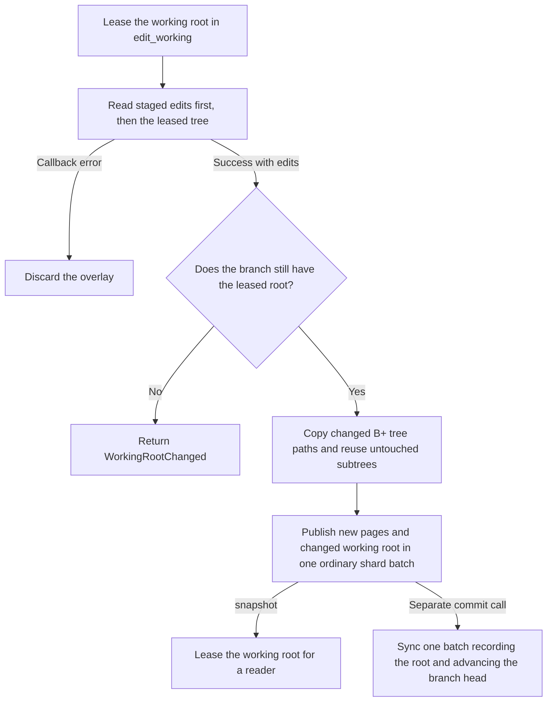

# VSDB storage architecture

The `vsdb` crate defines collections and their key and value encodings.
`vsdb_core` stores their rows on MMDB 6 using shard format 5. A process opens
one **universe**, identified by its base directory and universe header.

| Term | What it identifies |
| --- | --- |
| Namespace | A storage root and its group of shards. The universe registry records additional namespaces and their placement. |
| Shard | One MMDB database in a namespace, with its own write-ahead log (WAL) and read sequence. |
| Prefix | An eight-byte map identifier allocated by the universe. All rows with that prefix live on the same shard. |
| `InstanceId` | A map ID and its namespace in this universe. With saved handle metadata, it lets the application reopen the collection. |

## From a collection handle to a shard

`MapxOrd` encodes ordered keys and their values. VerMap encodes tree pages,
blobs and branch records. Both address those rows through
`vsdb_core::MapxRaw`. [Typed collections](../strata/README.md#choosing-a-collection) · [Raw map implementation](../core/src/basic/mapx_raw/mod.rs)

Two prefixes in the same namespace can route to different shards. DagMap
deliberately allocates a child prefix on its parent's shard so it can publish
the child and the parent edge together. [Namespace layout and lifecycle](namespaces.md) · [MMDB adapter](../core/src/common/engine/mmdb.rs)

## Batch publication and captured reads

For a nonempty map batch, the shard is the unit of atomic visibility.
The two commit modes differ in when the writer can rely on the WAL for
power-loss recovery.

A `read_view()` captured before publication continues to read its original
sequence for both point lookups and scans. After an ordinary commit,
`try_sync_wal()` on the map can make earlier WAL-backed writes durable
without publishing another edit. DagMap's `insert_colocated` path checks
that the two raw handles share an engine and shard before submitting one
batch across their prefixes. A namespace-wide fence visits each shard
individually. [Read views, fence scope and write errors](storage.md)

## VerMap working edits and history

A branch records both a working tree root and the ID of its latest history
commit. Writers through aliases of the same store must serialize their operations.

The history entry links to the previous head when one exists. A reader can
open a retained commit with `at(commit)`. Its root lease keeps that tree
readable across later edits and rollbacks. [Working edits and publication](../strata/src/versioned/map.rs) · [Branches, snapshots and recovery](../strata/docs/versioned.md)
