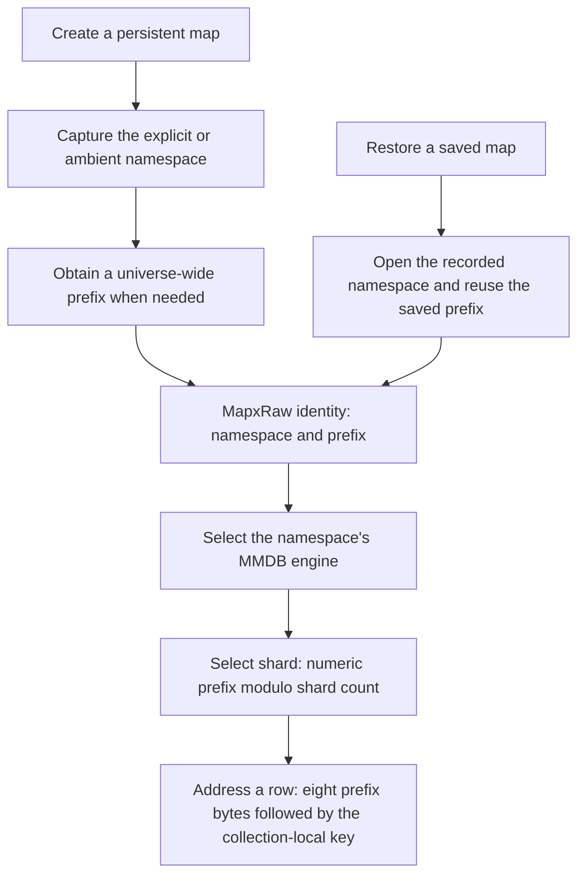
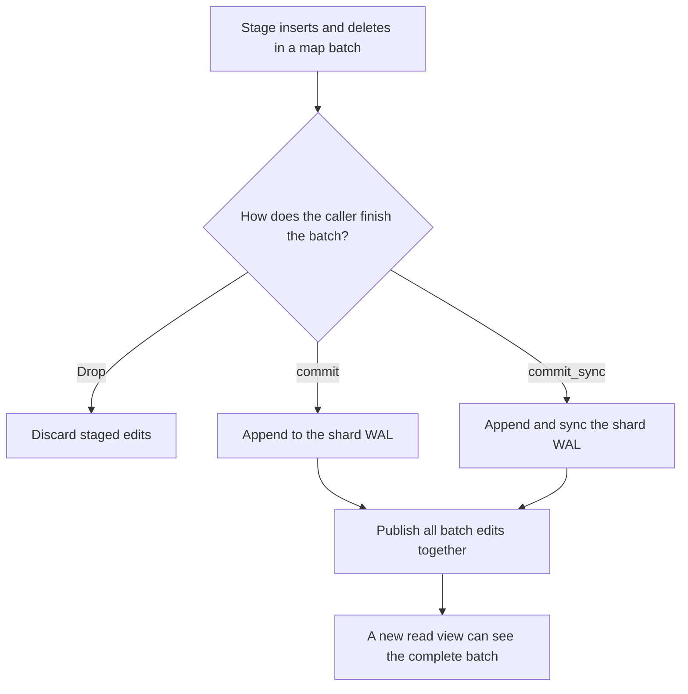
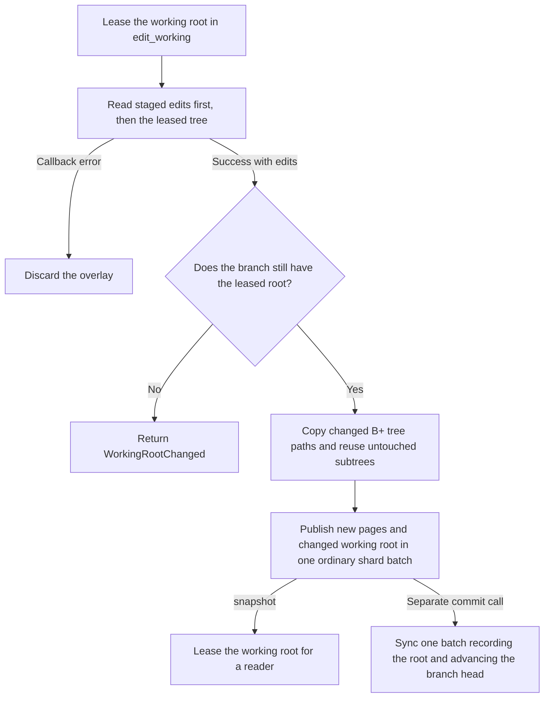
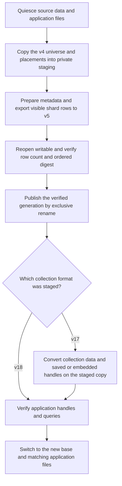

# VSDB v18 architecture on MMDB v5

Applications use the collections in `vsdb` (the `strata/` crate).
`vsdb_core` places their persistent data in namespaces backed by MMDB v5.
The offline converter also reads MMDB 4.3.15. A fresh universe
can be created directly on v5. To upgrade an existing v17/v4 or v18/v4
universe, stop the application and stage a complete new generation with
`vsdb-stage-v5`. A v17 application must also convert its saved and embedded
collection handles. [Migration procedure](../migration/README.md) · [Workspace dependencies](../Cargo.toml)

## From a collection handle to a shard

The `vsdb` crate defines what a collection stores. For example, `MapxOrd`
encodes ordered keys and values, while VerMap encodes tree pages, blobs and
branch records. Both use `vsdb_core::MapxRaw` to address those rows. Applications
can also use the raw map directly. The in-memory Merkle calculators operate
on caller-supplied data. [Collection APIs](../strata/docs/api.md) · [Raw map implementation](../core/src/basic/mapx_raw/mod.rs)

The universe owns the namespace registry and the prefix allocator. Every row
under one prefix routes to the same shard. Each shard has its own write-ahead log (WAL) and
read sequence. DagMap exploits this routing rule when it allocates a child
prefix on its parent's shard. [Namespace layout and lifecycle](namespaces.md) · [MMDB adapter](../core/src/common/engine/mmdb.rs)

## Batch publication and captured reads

For a nonempty map batch, the shard is the unit of atomic visibility.
The two commit modes differ in when the writer can rely on the WAL for
power-loss recovery.

A `read_view()` captured before publication continues to read its original
sequence for both point lookups and scans. After an ordinary commit,
`try_sync_wal()` on the map can make earlier WAL-backed writes durable
without publishing another edit. DagMap's `insert_colocated` path checks
that the two raw handles share an engine and shard before submitting one
batch across their prefixes. A namespace-wide fence visits each shard
individually. [Read views, fence scope and write errors](storage.md)

## VerMap working edits and history

A branch records both a working tree root and the ID of its latest history
commit. The following path shows a dependent edit that changes the root.
Writers through aliases of the same store must serialize their operations.

The history entry links to the previous head when one exists. A reader can
open a retained commit with `at(commit)`. Its root lease keeps that tree
readable across later edits and rollbacks. [Working edits and publication](../strata/src/versioned/map.rs) · [Branches, snapshots and recovery](../strata/docs/versioned.md)

## Storage and collection behavior

| Component | v18 behavior |
| --- | --- |
| Raw and typed maps | Typed lookups decode from pinned bytes, and checked cursors report late storage errors. An occupied value guard writes back after mutable access. [Writes, reads and memory](storage.md) · [Typed collections](../strata/docs/api.md) |
| VerMap and PersistentBTree | Both use slotted copy-on-write pages and store encoded values larger than 1 KiB in separate blobs. VerMap keeps the pages, blobs and version metadata under one prefix. Recovery handles private staged pages, retired roots and verified reference-count checkpoints. [Versioned storage](../strata/docs/versioned.md) |
| Merkle proofs | MPT and SMT retain v17 root and proof encodings. A version-store checkpoint identifies its universe, map, commit and tree root. A restored map can rebuild its trie from the stored rows. [Proof APIs](../strata/docs/api.md#proof-transport) |
| SlotDex | Fixed-width slot encodings preserve order. The total row includes the writer generation. A mutation checks the generation before publishing entries and counts. A query reads entries, tiers and counts at one snapshot. Descending iteration keeps keys within each slot in ascending order. [SlotDex API](../strata/docs/api.md#slotdex) |
| DagMap | Each child inherits the parent's namespace and shard. One batch writes the child owner, the parent edge and the next edge ID. Readers at the previous snapshot retain the previous graph. Pruning uses resumable steps. [DagMap API](../strata/docs/api.md#dagmap) |
| VecDex | A search traverses one HNSW snapshot and decodes one pinned vector at a time. Bulk insertion stages graph rows and state in chunks of up to 64 distinct keys. Each chunk publishes atomically. Earlier chunks can remain visible if a later chunk fails. [VecDex guide](../strata/docs/vecdex.md) |

## Offline migration and application cutover

The separate `vsdb_migrate` crate reads the v4 source and builds a new v5
generation. Physical staging preserves visible key/value rows, including
recovered WAL updates. Application-owned files outside the universe and its
placements must be staged separately. [Staging implementation](../migration/src/universe/staging.rs)

Verification reopens each exported shard with the adapter's seven levels and
eight-byte prefix. The application fixture checks an embedded map handle, a historical
commit and Merkle proof, DAG ownership, slot order and exact vector-query
results on the converted generation. A separate fixture covers an SST-only
row and updates in a residual WAL. [Migration procedure and rollback](../migration/README.md) · [Collection fixture](../migration/tests/collections_generation.rs) · [Shard fixture](../migration/tests/staged_generation.rs)

## Measured performance

For the upgrade impact on writes, DagMap publication, B+ tree reads and
VecDex queries, see the [MMDB v4 to v5 comparisons](evaluations/README.md#mmdb-v4-to-v5-with-vsdb-v18).
The [collection-layout trials](evaluations/README.md#v17-to-v18-collection-layouts-on-mmdb-v4)
hold the engine at MMDB 4.3.15 to measure the change from VSDB v17 to v18.

## Correctness validation

At VSDB `1b51384` with MMDB `255015a`, native Linux/x86_64 passed the
seven workspace checks, including **850 passing tests in debug, 850 in
release and 26 doctests**. Debug and release cover the same suites. The
recorded run covers Linux/x86_64. Native macOS/Arm validation uses the
same workspace gate on the target machine, including exclusive publication,
filesystem locking and writable reopen on local storage. [Validation receipt](validation/v18-linux-x86_64.json) · [Workspace gate](ai/commit-protocol.md#final-workspace-gate)
