# Versioned Module — Architecture & Internals

This document explains the design, data flow, and internal mechanisms of `VerMap`,
the Git-model versioned storage engine in `vsdb`.

---

## Table of Contents

- [Architecture Overview](#architecture-overview)
- [Layer Architecture](#layer-architecture)
- [Core Data Structures](#core-data-structures)
- [Lifecycle: Create → Write → Commit → Branch → Merge](#lifecycle)
- [Copy-on-Write & Structural Sharing](#copy-on-write--structural-sharing)
- [Commit DAG](#commit-dag)
- [Three-Way Merge Algorithm](#three-way-merge-algorithm)
- [Durability and Recovery](#durability-and-recovery)
- [Garbage Collection](#garbage-collection)
- [Fork Point & Commit Distance](#fork-point--commit-distance)
- [Rollback & Discard](#rollback--discard)
- [Summary](#summary)

---

## Architecture Overview

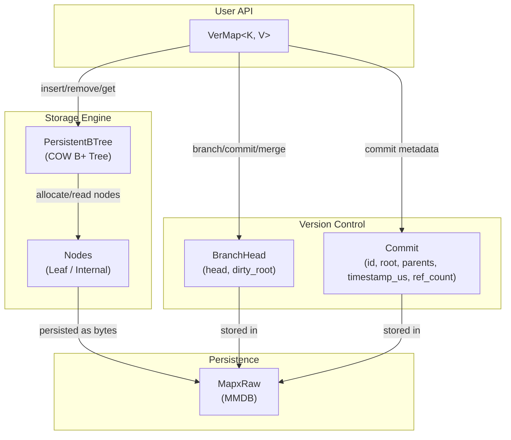

---

## Layer Architecture

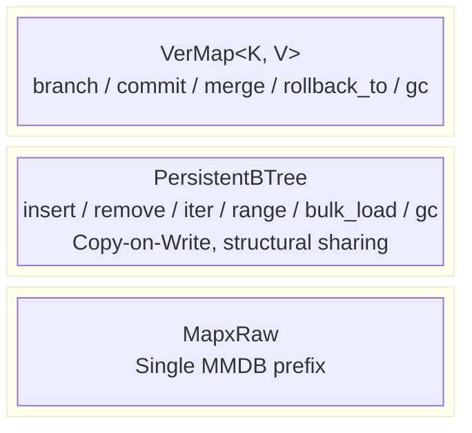

Each `VerMap` persists its state in a single `MapxRaw` prefix.

| Key tag | Contents |
|---|---|
| `00` | Format, monotonic ID ceilings, main branch, generation |
| `01`, `02`, `03` | Branch head and working root, branch name by ID, reverse lookup by name |
| `04` | Immutable commit state plus mutable reference count |
| `05`, `06` | Retired roots and unpublished staged subtrees |
| `07` | Checksummed reference-count checkpoint |
| `10`, `12` | Slotted B+ tree pages and value blobs |

---

## Core Data Structures

`BranchId` and `CommitId` are distinct serde-transparent `u64` newtypes.
Both implement `KeyEnDeOrdered`, so they can key `MapxOrd`, `VerMap`, and
`SlotDex` with the same big-endian key encoding as their former `u64` aliases.
Branch and commit keys contain their big-endian numeric IDs.

### Commit

```
Commit {
    id:           CommitId  (transparent u64 newtype),
    root:         NodeId    (B+ tree root snapshot),
    parents:      Vec<CommitId>,
    timestamp_us: u64,
    ref_count:    u32,       // branch HEADs + child parent-links
}
```

- `parents.len() == 0` → initial commit
- `parents.len() == 1` → normal linear commit
- `parents.len() == 2` → merge commit `[target_head, source_head]`

### BranchHead

```
BranchHead {
    head:       CommitId,   // latest committed snapshot (0 = no commits yet)
    dirty_root: NodeId,     // uncommitted working-tree root
}
```

### B+ Tree Node (B = 16, max 32 keys per node)

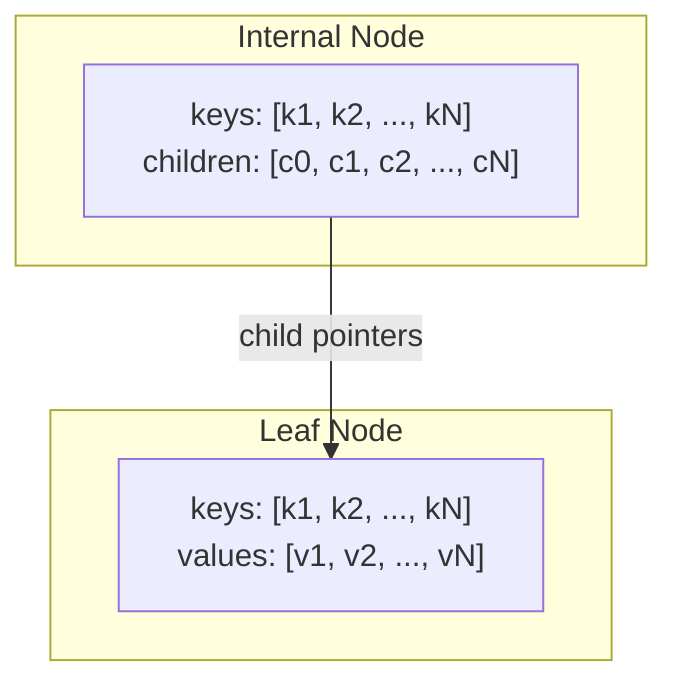

A `NodeId` combines a monotonically allocated 62-bit serial with a two-bit class.
The classes distinguish internal nodes, inline leaves, leaves with blobs and blobs.
Leaf values over 1024 encoded bytes use separate blobs. A point lookup
binary-searches borrowed keys inside each fetched page. The forward iterator
retains the current leaf page and reads only the selected values.
`EMPTY_ROOT = 0` is the sentinel for an empty tree.

---

## Lifecycle

### Overview

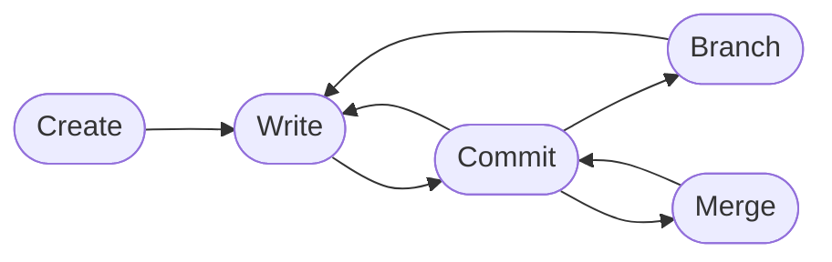

Typical flow: **create → write → commit → branch → merge**
(GC is automatic — no explicit step needed)

### Detailed Step-by-Step

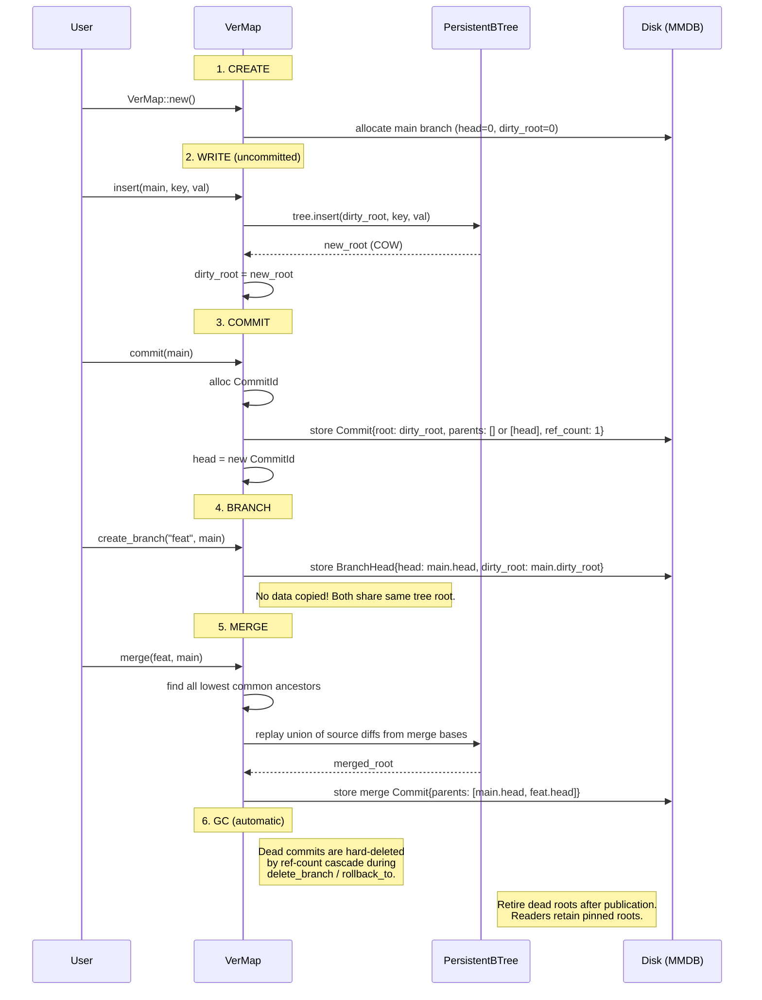

---

## Copy-on-Write & Structural Sharing

Branching copies only branch metadata and retains existing roots; it does not
copy entries. The operation still performs writes and a durability sync.
Both branches point to the **same B+ tree root**. The first mutation
triggers copy-on-write, allocating only the modified path (~O(log n) nodes).

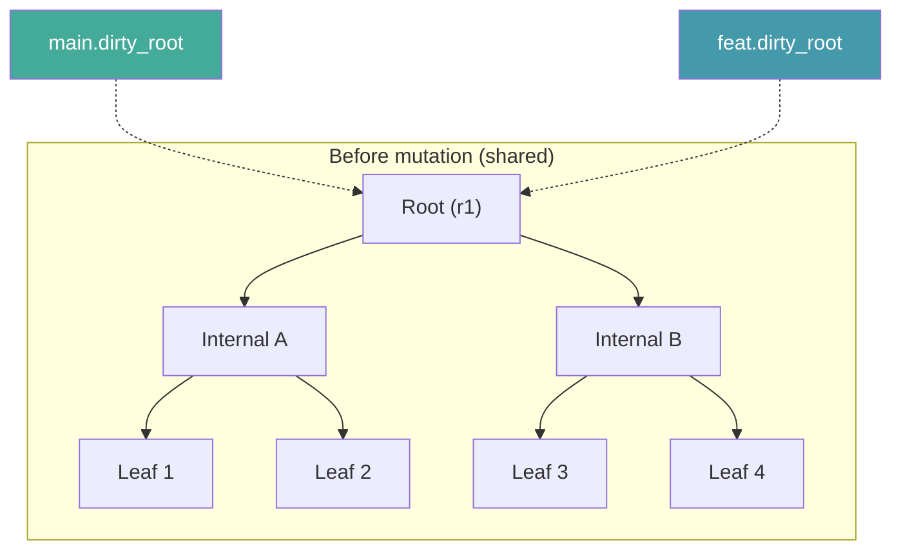

After `feat.insert(key_in_leaf3, new_val)`:

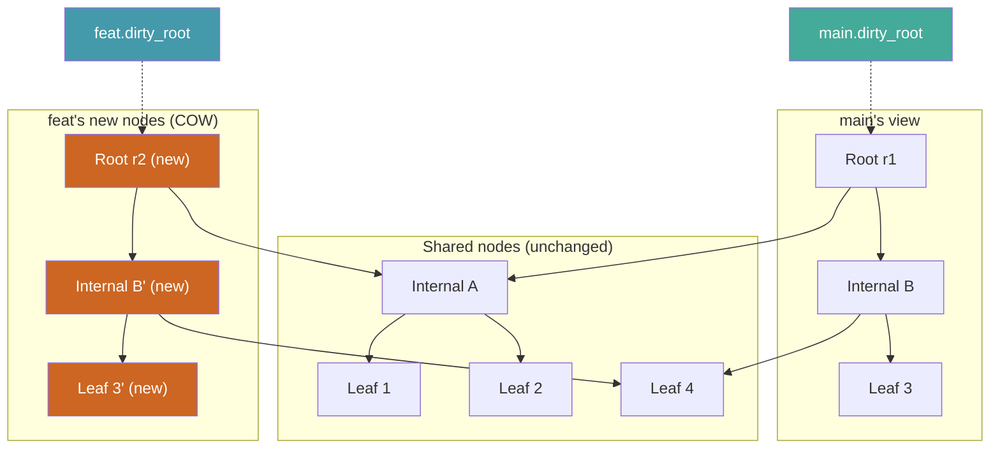

> Only 3 new nodes allocated (red). The 4 shared nodes (Internal A, Leaf 1, Leaf 2, Leaf 4) are referenced by both versions simultaneously.

---

## Commit DAG

Commits form a **Directed Acyclic Graph** via parent pointers.
Linear commits have one parent; merge commits have two.

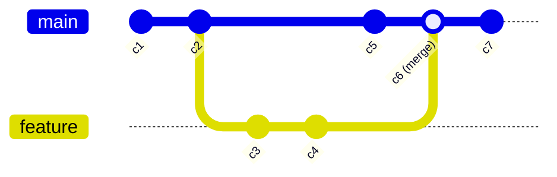

### Commit Parent Relationships

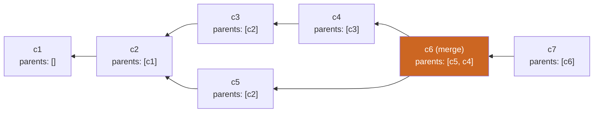

Each commit's `root` field is a **snapshot** — an immutable B+ tree root that
captures the full state of the map at that point in time.

`at(commit)` and `snapshot(branch)` return a read-only view that retains its
captured tree root. Later changes through a restored alias, including rollback
and branch deletion, do not change the view. Its iterators share that retention
and can outlive the view itself. Capturing a view updates only runtime ownership;
it does not write persistent state or copy entries. Iteration remains streaming.

A view keeps its tree nodes alive until it and all its iterators are dropped. It
does not keep the commit record or branch alive, so a later `at(commit)` can fail
for a deleted commit even while an existing view still reads its contents.

---

## Three-Way Merge Algorithm

### Overview

`merge(&mut self, source: BranchId, target: BranchId) -> Result<CommitId>`
finds all lowest common ancestors (merge bases) and replays source changes
onto the target. It rejects self-merge, uncommitted source or target branches,
and a source branch with no commits. Equal heads return the existing commit.
An empty target fast-forwards to the source head; every other successful merge
creates a two-parent commit, even when it can reuse an existing tree root.

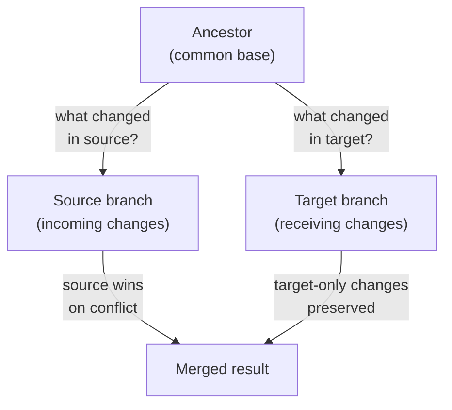

### Tree-root fast paths

For a single merge base, the B+ tree layer can reuse roots as follows. These
are tree-state shortcuts, not branch-history fast-forwards: the public
`VerMap::merge` still follows the commit rules above. Multiple merge bases
use the union of their source diffs.

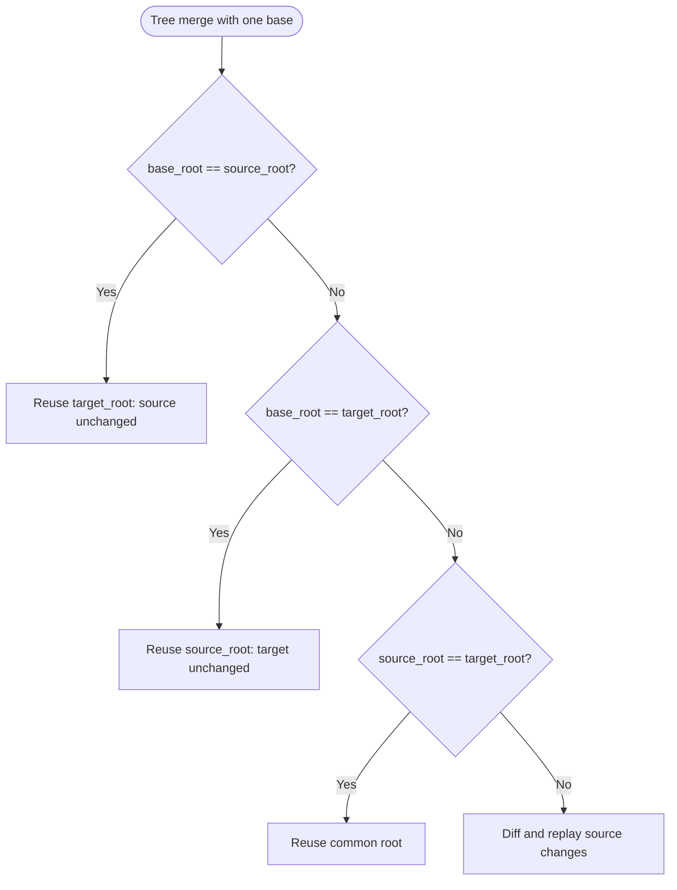

### Full Three-Way Merge Process

Every row of the conflict matrix below reduces to one rule: a key whose
source state differs from the ancestor takes the source state; every other
key keeps the target state. The merge therefore replays the source-side
delta onto the target tree instead of rebuilding it:

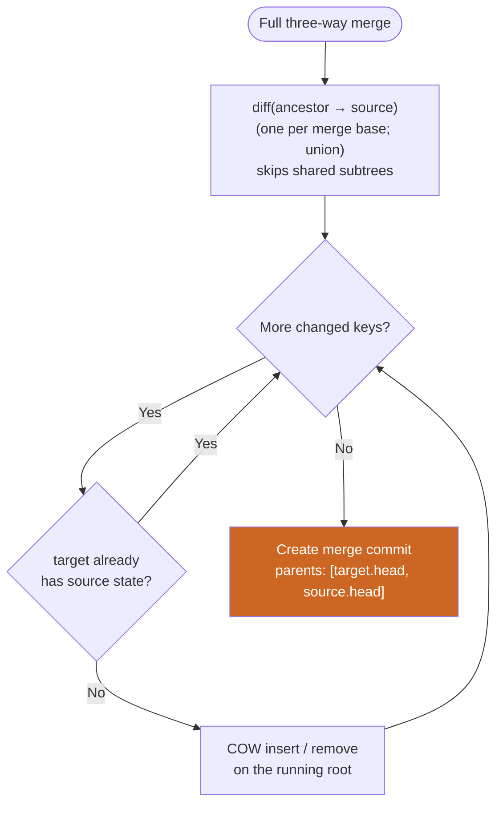

Diff skips subtrees with identical NodeIds. With structural sharing, this
limits work to changed paths; independently built trees can require a full
walk even when their contents match. Replay updates only the source delta
(roughly changed keys × tree depth), retaining unaffected subtrees. Finding
merge bases also walks commit history. All replay steps share one write
buffer, discarding intermediate versions before they reach the engine.
`diff_commits` / `diff_uncommitted` use the same shared-subtree skipping walk.

### Conflict Resolution Matrix

> **Rule: Source wins on conflict.**

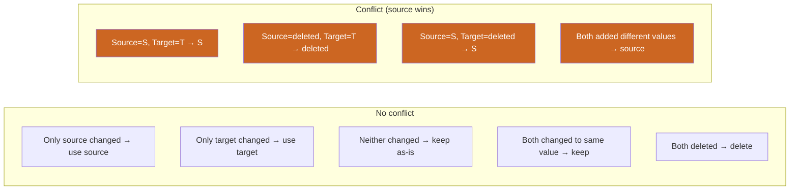

Full table:

| Ancestor | Source | Target | Result | Type |
|:---------|:-------|:-------|:-------|:-----|
| A | A | A | A | no change |
| A | **S** | A | **S** | source-only |
| A | A | **T** | **T** | target-only |
| A | **S** | **S** | **S** | both same |
| A | **S** | **T** | **S** | conflict → source wins |
| A | _deleted_ | A | _deleted_ | source-only delete |
| A | A | _deleted_ | _deleted_ | target-only delete |
| A | _deleted_ | **T** | _deleted_ | conflict → source wins |
| A | **S** | _deleted_ | **S** | conflict → source wins |
| A | _deleted_ | _deleted_ | _deleted_ | both deleted |
| _absent_ | **S** | _absent_ | **S** | source-only add |
| _absent_ | _absent_ | **T** | **T** | target-only add |
| _absent_ | **S** | **S** | **S** | both added same |
| _absent_ | **S** | **T** | **S** | conflict → source wins |

The caller controls priority by choosing which branch to pass as `source` vs `target`.

---

## Durability and Recovery

Working edits publish the new pages, allocator ceiling and 16-byte branch head in one atomic write batch. `write_batch(branch, edits)` sorts edits by encoded key, retains the last edit for duplicates and applies runs that share a leaf together. An ordinary insert or removal does not force a WAL sync.

History changes, including commits, branch management, rollback and merge, publish one synchronous batch. Readers observe the complete result after the WAL sync succeeds. An oversized merge or sorted `bulk_load` writes unpublished pages in approximately 16 MiB chunks. Each intermediate batch records the subtree roots at tag `06`. The final synchronous batch publishes the new root and removes its staging markers. An interrupted build leaves the previous branch state available.

An owned `Snapshot<K, V>` supports cloning and can move to another thread. `VerMap::reader()` shares the same namespace and pin table. The reader can take snapshots independently of the writer. Snapshot iterators retain their leases after the view or source map is dropped. Mutable `VerMap::clone()` and `clone_in(&namespace)` create independent stores, including all retained commits and working roots.

`flush()` and consuming `close()` checkpoint reference counts. A checkpoint includes the instance ID, the header generation and a Keccak256 digest. Open verifies branch heads and reachable parent links, checks root page headers and probes the ceiling of each object class. It accepts a matching checkpoint after validating its reference graph. A missing, stale or damaged checkpoint, or an unpublished or retired root marker, triggers a full recount. Read-only opens validate without writing repairs. Writable recovery mutates the store and requires the same writer exclusion as other structural changes. Use `reader()` alongside an active writer.

`from_meta_verified(id)` also checks every reachable slotted page, blob reference, separator, child height and occupancy. `verify_and_gc()` runs that verification on an open map and returns live object and commit counts and the number of removed orphan commits. Verification rejects missing reachable history and truncated allocator ceilings before reclamation.

Standalone `PersistentBTree` stores its allocator ceiling at tag `09` in the same batch as the pages it allocates. Both the versioned and standalone handles carry a fixed 36-byte typed frame. For offline conversion of external standalone root IDs, supply every root to `vsdb_migrate::versioned::migrate_tree_v17` and retain the returned ID mapping. [Migration guide](../../migration/README.md)

## Garbage Collection

Commits count branch-head and commit-parent references. Deleting a branch or rolling it back cascades through commits that lose their last owner. B+ tree objects count incoming edges and root owners. The runtime stores counts as `u32` and retains child lists only for objects with outgoing edges.

A unique writer includes the dead object keys in its publication batch. With readers or restored aliases present, the writer records retired roots at tag `05`. A successful publication withdraws ownership and queues unpinned objects for the next batch or checkpoint. Readers can pin the old root during a synchronous publication. The last snapshot lease releases its pin and queues any objects that have become unreachable. Engine compaction reclaims physical disk space.

### Example

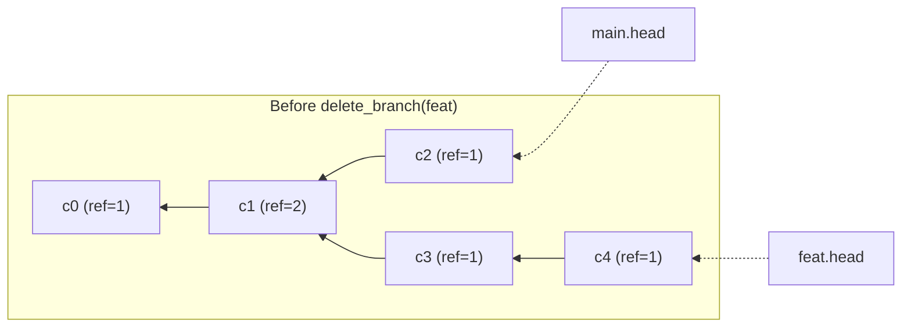

After `delete_branch(feat)`:
- Ref-count cascade immediately deletes **c4** (ref 1→0) and
  **c3** (ref 1→0).
- **c1** drops from ref=2 to ref=1 (still alive via c2).
- B+ tree nodes from c3/c4 with no remaining owner (including live views)
  are deleted with publication or queued for reclamation after the last reader releases them.
- MMDB can reclaim their disk space when compaction rewrites the affected SSTs.

---

## Fork Point & Commit Distance

These APIs support divergent-branch detection.

### Fork Point

`fork_point(a, b)` returns one **lowest common ancestor**. If criss-cross
history has several merge bases, it selects the greatest CommitId among them;
`merge` itself considers all bases. It returns `None` when no common ancestor
is found.

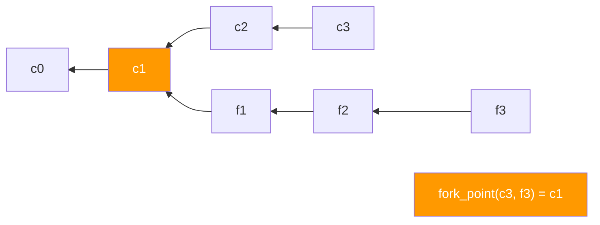

### Commit Distance

`commit_distance(from, ancestor)` counts hops on the **first-parent chain** only.

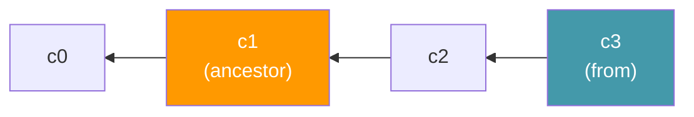

```
commit_distance(c3, c1) = 2    (c3 → c2 → c1, two hops)
```

Combined example:

```
Main:    c0 → c1 → c2 → c3
Fork:    c0 → c1 → f1 → f2 → f3 → f4

fork_point(c3, f4)       = c1
commit_distance(c3, c1)  = 2
commit_distance(f4, c1)  = 4
```

---

## Rollback & Discard

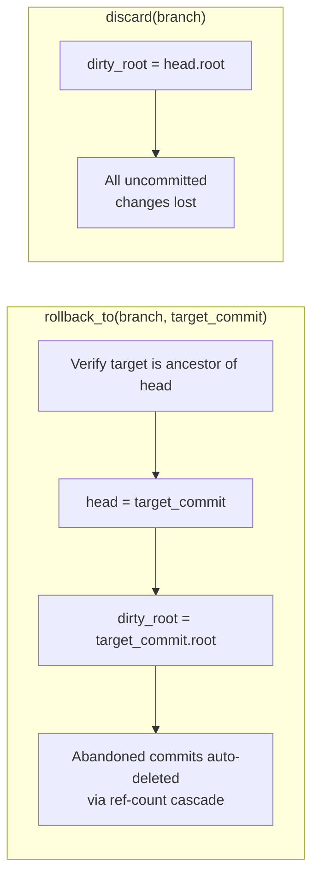

---

## Summary

| Concept | Mechanism |
|:--------|:----------|
| **Versioning** | Each commit snapshots a B+ tree root |
| **Branching** | Copies only a 16-byte `BranchHead` |
| **Isolation** | Each branch has independent `head` + `dirty_root` |
| **Structural sharing** | COW B+ tree — mutations allocate ~O(log n) nodes |
| **Merge** | All merge bases, shared-subtree diff, and source-delta replay; source wins on conflict |
| **GC** | Automatic ref-count cleanup and fenced node retirement; physical compaction reclaim is best-effort. `gc()` supports repair/full node sweeps |
| **Persistence** | All state stored in MMDB via `MapxRaw` |
