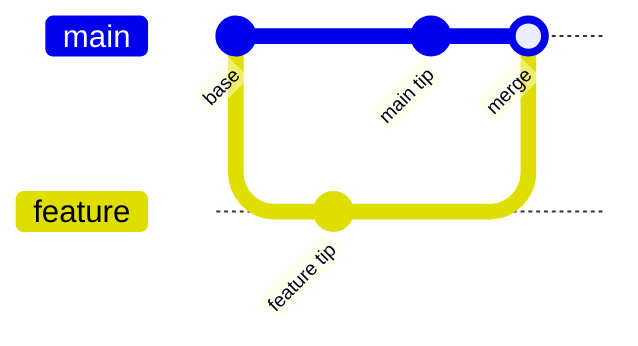

# VerMap branches, snapshots and recovery

`VerMap<K, V>` stores ordered keys in a copy-on-write B+ tree. A branch owns a
working root and points to its latest commit. Each commit records a tree root
and up to two parents. The working tree, commit graph and their metadata live
in one `MapxRaw` prefix on one shard.

## Branch and merge example

```rust
use vsdb::VerMap;

fn main() -> vsdb::Result<()> {
    let mut prices = VerMap::<u32, u64>::new();
    let main = prices.main_branch();
    prices.insert(main, &1, &10)?;
    let original = prices.commit(main)?;

    let sale = prices.create_branch("sale", main)?;
    prices.insert(sale, &1, &8)?;
    prices.commit(sale)?;
    assert_eq!(prices.get(main, &1)?, Some(10));

    prices.merge(sale, main)?;
    assert_eq!(prices.get(main, &1)?, Some(8));
    assert_eq!(prices.at(original)?.get(&1), Some(10));
    Ok(())
}
```

## Branches, commits and snapshots

| Operation | Effect |
|---|---|
| `new()` | Creates an empty `main` branch. Zero denotes an empty tree root or an absent head in the corresponding field. |
| `insert`, `remove`, `write_batch` | Edits the branch's working tree. A batch sorts edits by encoded key and the last edit for each key wins. |
| `edit_working` | Runs a callback that can read its own staged changes and publishes the resulting working root once. |
| `bulk_load` | Replaces the working tree from ascending encoded keys. Duplicate keys keep their final value. |
| `commit` | Records the working root, advances the branch head and links to the prior head when one exists. |
| `create_branch` | Inherits the source head and working root, including pending changes. The metadata update retains the shared roots. |
| `discard` | Resets the working tree to the head's root, or the empty root on a branch without commits. |
| `rollback_to` | Requires a clean branch and a retained commit reachable from its head. Resets head and working root to that commit. |
| `delete_branch` | Removes an ordinary branch and releases its references. Use `set_main_branch` to change which branch is protected. |

Updating a leaf allocates new pages along its path and keeps unaffected
subtrees shared. Splits and underflow repair can also touch neighboring pages.
A single-key insertion or removal that encounters an unreadable page returns
the storage error and preserves the working root. A missing or malformed
referenced page returns `VsdbError::Corrupt`. The same distinction applies to
`has_uncommitted`, `rollback_to`, `merge` and the commit and working-state
diffs. A merge that encounters such a read error leaves the target head in place.

A branch is clean when its stored keys and values match its head. Editing a
value and then restoring its original bytes makes the branch clean again.
`BranchId` and `CommitId` are distinct serde-transparent `u64` types with
ordered key encodings. Commit IDs increase with allocation. The wall-clock
timestamp is informational.

Use `snapshot(branch)` for the working state, including pending changes, and
`at(commit)` for a retained commit. Either returns an owned, cloneable
`Snapshot<K, V>`. It pins the captured root. Its ordered iterators share the
pin and can outlive the snapshot, reader and source map. A rollback or branch
deletion may reclaim the commit record while an existing snapshot continues
to read its tree. A new `at(commit)` then returns `CommitNotFound`.

Each call to `head_commit` or `log` sees a consistent branch history. It
checks for overlapping publication, including changes to commit reference
counts. Readers can use the previous generation during a WAL sync. A
captured engine view bounds retries if history keeps advancing during a read.

Use `reader()` to acquire snapshots alongside an active writer. Serialize
writers and writable restores through aliases of the same store. Mutable
`clone()` and `clone_in(&namespace)` deep-copy branches, retained commits and
working trees into an independent store.

## Dependent working edits

Use `VerMap::edit_working(branch, max_bytes, |edit| ...)` when a later edit
reads an earlier one in the same operation. The callback starts from a
retained working root. Its `get`, `insert` and `remove` see the overlay in
call order. Returning an error or unwinding discards the overlay. A successful
callback publishes the resulting working root once if it changed. Call
`commit` separately to create a durable history entry. Serialize writers to
aliases as for other structural operations. If a callback changes the
working root through another alias, publishing the original overlay reports
`VsdbError::WorkingRootChanged`. A budget violation reports `InvalidConfig`.

When the key has no staged edit, the callback checks its path from the captured
root. An absent key returns `None`; a missing referenced page or blob and a
malformed page return `Corrupt`. An underlying read failure preserves its
storage error. Returning such an error from the callback discards earlier edits.

The limit charges the encoded key and current value plus 64 bytes per
distinct staged key, including a deleted key. Replacing an entry releases
its old value's charge. Caller allocations, transient encoding and tree
publication buffers lie outside this overlay budget. Use `write_batch` when
all values are known before the operation.

```rust
use vsdb::VerMap;

fn main() -> vsdb::Result<()> {
    let mut balances = VerMap::<u32, u64>::new();
    let main = balances.main_branch();
    balances.edit_working(main, 1024, |edit| {
        edit.insert(&1, &10)?;
        let balance = edit.get(&1)?.unwrap();
        edit.insert(&1, &(balance + 5))
    })?;
    assert_eq!(balances.get(main, &1)?, Some(15));
    Ok(())
}
```

## Three-way merge algorithm

`merge(source, target)` requires different, clean branches and a source with
a commit. Equal heads return that commit. A target with no head advances to the
source head. For other successful merges, the target receives a new commit
with parents `[target_head, source_head]`, even when it can reuse a tree root.

The merge walks parent links to find all lowest common ancestors. With one
base, a key takes the source value (or deletion) when the source changed
relative to the base. Other keys keep the target state.

| Change to a key since the base | Merged value |
| --- | --- |
| Only the target changes the key | Target value, including deletion |
| Only the source changes the key | Source value, including deletion |
| Both change the key | Source value, including when the source deletes a key the target edited |
| Neither changes the key | Original value or absence |

With several merge bases, a source change relative to *any* base counts.
With no common ancestor the merge uses the empty tree as its base. A
comparison can reuse identical roots and skip subtrees with equal node IDs.
Independently built trees can require a full diff. Sorted source changes
for the same target leaf are applied together, and copy-on-write retains
unaffected target subtrees.



`fork_point(a, b)` returns the greatest commit ID among the lowest common
ancestors, or `None` if there is none. `commit_distance(from, ancestor)`
counts first-parent hops only. The merge is one hop from the main tip.
The feature tip is its second parent.

## Storage layout

| Key tag (hex) | Contents |
|---|---|
| `00` | Format, monotonic ID ceilings, main branch and generation |
| `01`, `02`, `03` | Branch head and working root (16 bytes), name by branch ID, reverse lookup by name |
| `04` | Commit root, parents, timestamp and reference count |
| `05`, `06` | Retired root markers and unpublished staged subtree markers |
| `07` | Checksummed reference-count checkpoint |
| `10`, `12` | Slotted B+ tree pages and value blobs |

A node ID combines a 62-bit serial and a two-bit class for internal pages,
inline leaves, leaves with blobs, or blobs. Pages hold up to 32 keys. Leaf
values over 1 KiB of encoded data use separate blobs. A point lookup
binary-searches borrowed keys inside each fetched page. Forward iteration
retains the current leaf page and reads selected values.

### Standalone tree roots

`PersistentBTree` exposes the same page and blob layouts to callers that
manage their own root IDs. It stores its allocator ceiling at tag `09`
alongside each allocation batch. Both tree and VerMap handles carry a
36-byte `VSTYPE04` frame.

For a standalone tree, persist the tree handle and every root ID the
application needs. On reopen, pass all live roots to `rebuild_ref_counts`.
Pass the same complete set to `gc` for a full sweep. Pages reachable only
from omitted roots can be reclaimed. VerMap tracks its own branch and commit
roots. [Standalone B+ tree API](../src/basic/persistent_btree/mod.rs)

## Durability and recovery

`insert`, `remove`, `write_batch`, `edit_working` and `discard` publish working-root changes
in one ordinary shard batch. This includes the new pages and allocator
ceiling. A successful edit is visible immediately and needs a WAL fence for
power-loss durability. Commits, branch administration, rollback, merge and
`bulk_load` publish changes using a synchronous batch. An operation that
returns early, such as merging equal heads, provides no additional fence.

A value encoding error from `write_batch` or `bulk_load` returns to the caller
and preserves the previous working root. Large merges and bulk loads may write
unpublished pages first. Each staging
batch records its subtree roots at tag `06`. These batches target 16 MiB per
chunk, with larger individual blobs written alone. The final synchronous batch
publishes the root and removes the markers. An interruption before publication
leaves the previous branch state reachable. An I/O error during publication
can leave a complete recoverable WAL record.

Reopen validates the header, allocator ceilings, branches, reachable commit
graph and root page headers. Writable `flush()` and consuming `close()`
checkpoint reference counts with the map ID, header generation and a Keccak256
digest. If the checkpoint matches and its reference graph validates, ordinary
reopen can skip a full object walk. A missing, stale or invalid checkpoint, or
any staged or retired marker, triggers a recount. Writable recovery can repair
derived metadata and remove unreachable objects. Read-only recovery validates
in memory and returns `VsdbError::Corrupt` if the branch-name index requires
repair. A writable reopen rebuilds that index from the branch records.

`from_meta_verified(id)` and `verify_and_gc()` also verify reachable pages,
blob references, separators, child heights and occupancy. The latter reports live object
and commit counts and identified orphan commits. [Recovery implementation](../src/versioned/repair.rs)

## Garbage collection

A commit counts the branches that point to it and the child commits that name
it as a parent. Deleting or rewinding a branch releases the old head.
Dropping the last reference deletes the commit and releases each parent in
turn. Merged history can therefore remain reachable after the source branch
is deleted.

Tree objects count incoming edges and roots. A writer with exclusive runtime
ownership can include newly dead object keys in its publication batch. When a
reader, lease or restored alias shares the runtime, publication records retired
roots at tag `05`. Runtime pins retain objects for existing snapshots. Unpinned
dead objects are queued for a later publication or checkpoint. MMDB can
reclaim physical disk space during compaction.
